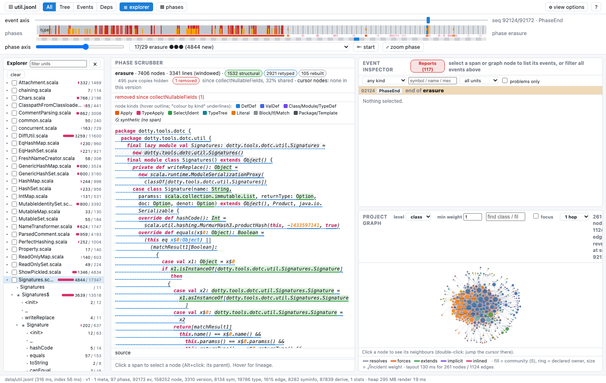
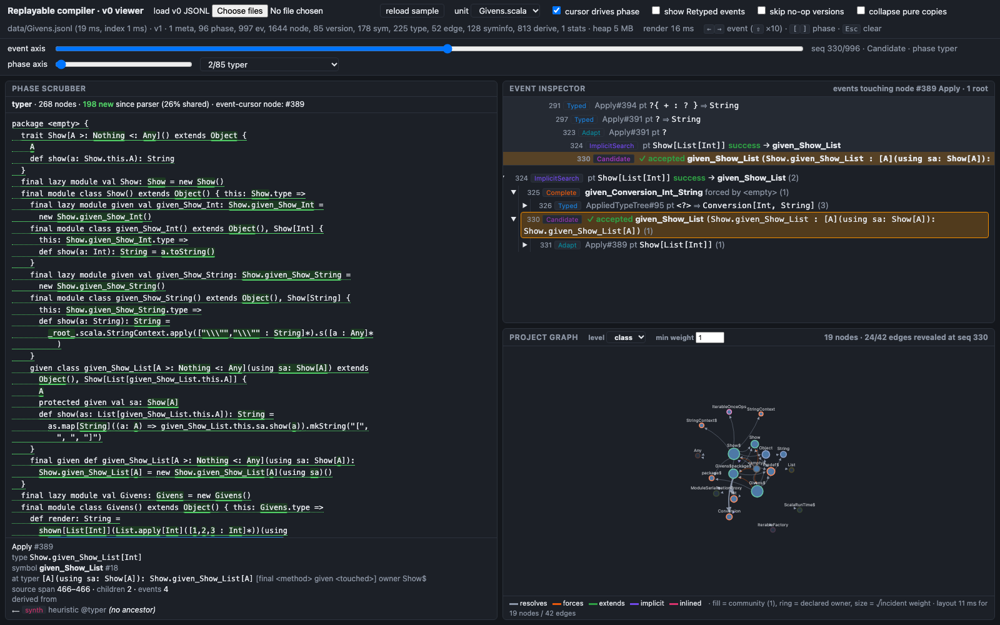
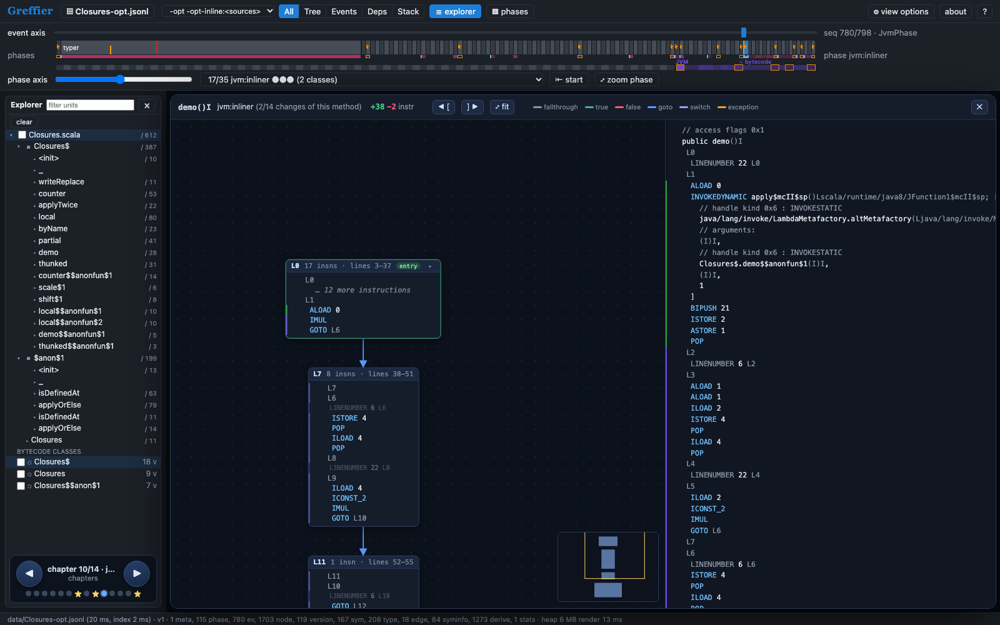
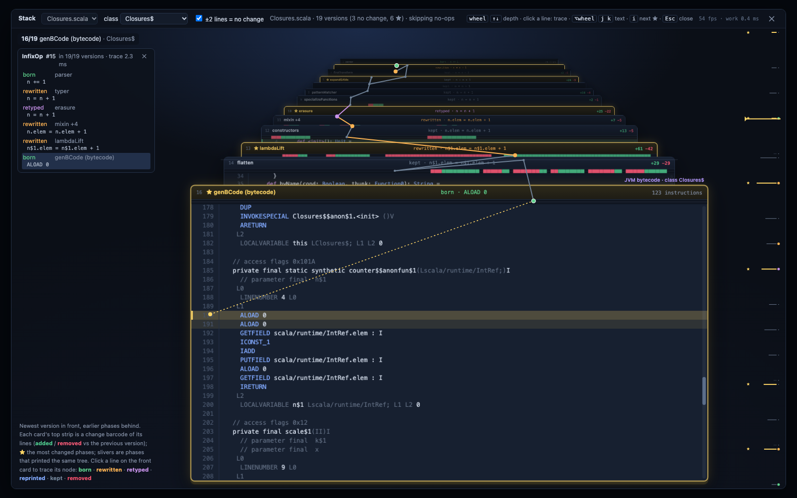

# Greffier

A replayable record of a Scala compile, and a viewer to scrub through it.

A recorder attached to the compiler writes one JSONL stream per compile: the printed tree after every phase (with node offsets, so the text is addressable), the typer's decisions (typing, adaptation, completions, implicit searches with the candidates that lost and why, tentative typing that was discarded, diagnostics), symbol info as it changes across phases, lineage between tree nodes across phases, and the generated bytecode per class with tree-to-instruction lineage and the optimiser's passes. The viewer loads such a stream and shows it as a phase scrubber, an event inspector, a project explorer with "chapters" to page through, a dependencies panel, a bytecode pane with a per-method control-flow graph, and a 3D stack of versions. A local compile server makes it Scastie-like: type code, pick a Scala version, compile with the recorder attached, see the result.

Demo (static recordings of the corpus): https://greffier.zaugg.id.au

Supported compilers: Scala 3.3 LTS, 3.7, 3.10 and nightlies (the recorder runs on unmodified compilers through a Java agent), Scala 2.13.

This is a proof of concept written with LLM assistance throughout (Claude, via sessions managed by the author). It is not an official Scala project.

## Screenshots

The phase scrubber, explorer with chapter paging, event inspector and dependencies panel on `dotc/util`:



Implicit search for `List(1, 2, 3).shown`, the chosen candidate and the nested search for its `using` argument:



A method's control-flow graph at the inliner step, with the listing beside it and the phase navigation still live:



The stack view: one expression traced from the parser through typer, erasure and lambdaLift into its bytecode range:



## Layout

| path | what |
|---|---|
| `DESIGN.md` | the design doc, kept as a running log: problem, prior art, measurements, decisions |
| `viewer/` | the viewer: `index.html` plus plain JS modules, no build step; `REPORT.md` is its change log, `TOURS.md` guided tours |
| `server/` | the local compile server (Python stdlib, compilers fetched with coursier); `README.md` has the API |
| `recorder/scala3/plugin` | the dotc recorder: a `ResearchPlugin` that unfuses miniphases and records after every phase |
| `recorder/scala3/agent` | a Byte Buddy `-javaagent` that installs the recorder's hooks on an unmodified dotc by pinned join points, per version |
| `recorder/scala2` | the nsc recorder plugin and agent for Scala 2.13 |
| `corpus/` | small Scala files the recordings, reports and tours refer to (`recorder/scala2/corpus` has 2.13 equivalents) |
| `deploy/` | the Cloudflare Worker that serves the demo |
| `docs/` | the stream schema (`SCHEMA-v1.md`), the measurement reports from each stage, a learner evaluation, QA rounds, and the miniphase fusion-order bugs found along the way |
| `compiler-patches/scala3` | the optional in-tree hooks (a `TyperObserver` interface, backend hook sites, deterministic `Name` hashes, a `TimeTravellingTreeCopier` fix) as a diff against scala/scala3; the agent makes these unnecessary, they exist to prove the agent byte-identical and as the upstream candidate |

## Running it

Requirements:
- Python 3.9+ (the server and scripts use the standard library only).
- A JDK 17 or newer with `javac`. The server uses `JAVA_HOME_REPLAY`, else `JAVA_HOME`, else what `/usr/libexec/java_home` or `javac` on the PATH points at.
- [coursier](https://get-coursier.io/) (`cs` or `coursier` on the PATH, or `COURSIER=<path>`), which fetches the compilers and Byte Buddy. No sbt and no Scala installation are needed; the recorder is compiled by the fetched compiler itself.
- For the demo deploy only: Node (for `npx wrangler`) and a Cloudflare account.

Configuration is by environment variable; there is no config file.

| variable | default | meaning |
|---|---|---|
| `JAVA_HOME_REPLAY` / `JAVA_HOME` | the OS's JDK | JDK used to build the recorder and run compiles |
| `COURSIER` | `coursier` or `cs` | coursier launcher |
| `GREFFIER_TIMEOUT_S` | `120` | per-compile timeout |
| `REPLAY_AGENT_OPTS` | `fixTypeApply,rejected,tentative,research` | agent options the server passes (see `docs/REPORT-agent.md`) |

Record and view locally:

```bash
python3 server/server.py --ui viewer
```

then open http://127.0.0.1:8777/ (`--port`, `--host` to change), press `c`, pick a version, compile. The first compile for a version fetches that compiler and builds the recorder for it (10 s to a couple of minutes, cached under `server/versions/`). Versions can also be prepared ahead: `python3 server/versions.py setup 3.7.4`, `setup 2.13.18`, `setup nightly`. The API, limits and workspace layout are in `server/README.md`.

Only view existing recordings:

```bash
python3 -m http.server 8766 --directory viewer
```

with recordings in `viewer/data/` and `python3 viewer/gen_index.py data` run once to list them. Recordings are also made without the server by `server/client.py` or, for development against a scala3 checkout, by the scripts in `recorder/scala3/plugin` (`env.sh` documents `REPLAY_COMPILER_CLASSPATH`, `REPLAY_STOCK_CLASSES`, `REPLAY_COMPILER_CLASSES`).

Deploy the demo: `wrangler login`, set the hostname in `deploy/wrangler.toml`, then `deploy/build.sh --deploy` (`--upload` as well once R2 is enabled, for recordings over 25 MiB).

## Status

See the "Decisions" and "Results" sections of `DESIGN.md`. Known gaps: no per-definition typer snapshots (the typer still appears as one step in the tree view; events are the fine axis), rejected implicit candidates come from the agent's hooks on the search internals and depend on the compiler version, and released Scala 3 compilers hash names by table offset so their streams are not guaranteed identical from run to run.

## Licence

Apache License 2.0, see `LICENSE`.
